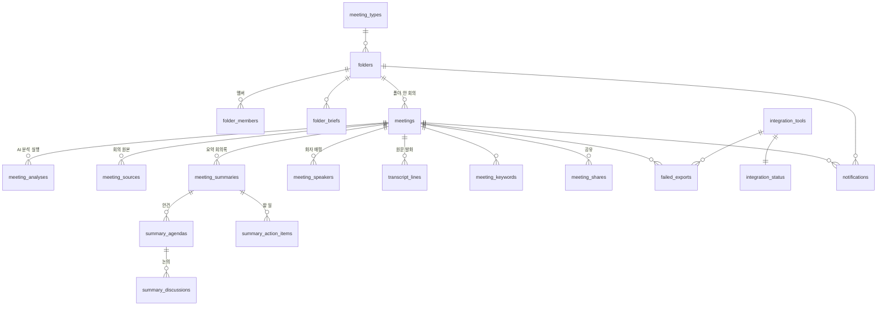

# PostgreSQL 가이드 (처음 하는 사람용)

> 우리 프로젝트는 **Neo4j = 온톨로지(사람·조직·회의 내용·할 일·주제의 관계)**, **PostgreSQL = Neo4j 에 없는 나머지** 로 나눕니다.
> 이 문서만 따라 하면 내 컴퓨터에 PostgreSQL 을 띄우고, 데이터를 넣고, 앱을 DB 로 돌릴 수 있어요.
>
> **이 폴더는 `web` 폴더를 한 줄도 고치지 않아요.** web 코드를 가져다 쓰기만 하고, 실행할 때 데이터 함수만 PostgreSQL 것으로 바꿔 끼워요.
> 그래서 web 을 수정 중인 팀원과 충돌하지 않아요. web 작업이 끝나면 9장대로 web 안으로 옮기면 돼요.

```
remeet/
├── web/                          ← 팀원이 수정 중 (안 건드림)
└── playground/
    ├── eunje/ontology/           ← Neo4j
    └── <내 이름>/postgres/        ← 이 폴더
```

---

## 0. 무엇이 어디에 있나

Neo4j 쪽 기준은 `playground/eunje/ontology` (`schema/schema.cypher`, `scripts/load.py`, `scripts/recommend_agent.py`) 입니다.

| 데이터 | Neo4j | PostgreSQL |
|---|:---:|:---:|
| 사람 · 팀 · 역할 · 스킬(숙련도) | | ✅ **구성원 표 (팀원 담당 · 이 폴더에는 없음)** |
| 프로젝트 · 주제 — `Project` `Topic` | ✅ | |
| 회의 참석자 | | ✅ `meeting_attendees` |
| 회의 상세: 요약 · 논의 · 결정 · 미해결 · 결과 · 안건(상세) · 근거 발화 | | ✅ `meeting_summaries` `summary_agendas` `summary_topics` `summary_points` |
| 액션 아이템 · 담당자 · 삭제/되돌리기 | | ✅ `meeting_todos` `meeting_todo_owners` |
| 안건 분리 요청 | | ✅ `branch_requests` |
| 담당자 추천 — `RECOMMENDED_FOR` | ✅ | |
| 위키 그래프 | ✅ | |
| **로그인 계정** (이메일 · 비밀번호 해시) | | ✅ `accounts` |
| **폴더** (회의 종류 · 주관자 · 멤버 · 브리프) — 폴더 id = `Project.project_id` | | ✅ `folders` … |
| **회의 관리 정보** (폴더 · 주관자 · 진행 상태 · 파일 · 요약 · 안건 분리 · 삭제) | | ✅ `meetings` |
| **회의 제목 · 날짜** (목록 정렬용) | | ✅ `meetings.title` `meetings.held_at` |
| **회의 원본 파일** (올린 회의록 그대로, 버전별) | | ✅ `meeting_sources` |
| **요약 회의록** (전체 요약 · 안건 · 논의 · 할 일, 버전별) | | ✅ `meeting_summaries` `summary_*` |
| **회의 원문 발화** (`summary.json` 의 `transcript`) | | ✅ `transcript_lines` |
| **화자 매핑** (A → 프로젝트 매니저 → u1) | | ✅ `meeting_speakers` |
| **AI 분석 실행 기록** (모델 · 설정 · 원본 경로 · 검토 이력 · summary.json 전체) | | ✅ `meeting_analyses` |
| 키워드, 공유, 외부 연동, 알림, 앱 설정 | | ✅ |

**왜 원문과 summary.json 원본이 PostgreSQL 에?**
- Neo4j `Discussion.evidence` 에는 `"86,87,88"` 처럼 **발화 번호만** 들어가요. 그 번호의 실제 문장은 Neo4j 에 없어서 `transcript_lines` 에서 찾아요.
- `load.py --reset` 은 Neo4j 회의 데이터를 지우고 summary.json 파일에서 다시 만들어요. 그 **원본 파일을 안전하게 보관**하는 곳이 `meeting_analyses.raw` 예요. (지금은 각자 컴퓨터의 파일)

### 두 DB 를 잇는 방법 = 같은 id 쓰기
| PostgreSQL | Neo4j |
|---|---|
| `meetings.id` | `Meeting.meeting_id` (예: `TS3003a`) |
| `folders.id` | `Project.project_id` (예: `TS3003`) |
| `*_user_id`, `sender_id` … | `Person.user_id` (예: `u1`) |
| `transcript_lines.line_id` | `Discussion.evidence` 안의 번호 |

다른 DB 에 있는 값은 **외래 키(REFERENCES)로 묶을 수 없어요.** 그래서 이런 칸은 그냥 `TEXT` 이고, "그런 사람이 진짜 있나"는 코드에서 확인해야 해요.

---

## 1. 꼭 알아야 할 개념 5개

| 용어 | 뜻 | 우리 프로젝트 예 |
|---|---|---|
| **RDB** (관계형 DB) | 데이터를 엑셀 시트 같은 **표(테이블)** 여러 개로 저장하는 DB. PostgreSQL 이 그중 하나 | |
| **테이블 / 행 / 열** | 시트 / 한 줄 / 칸 | `folders` 표의 한 행 = 폴더 하나 |
| **기본 키 (PRIMARY KEY)** | 행을 하나로 딱 집어내는 값. 중복 불가 | `folders.id = 'rel'` |
| **외래 키 (FOREIGN KEY, REFERENCES)** | 다른 표의 기본 키를 가리키는 칸. 없는 값은 못 넣게 DB 가 막아 줌 | `meetings.folder_id → folders.id` |
| **SQL** | DB 에 말 거는 언어 | 아래 4가지만 알면 시작 가능 |

```sql
SELECT name FROM folders WHERE type_id = 'weekly';                       -- 읽기
INSERT INTO folder_members (folder_id, user_id) VALUES ('rel', 'dw');    -- 넣기
UPDATE meetings SET status = 'confirmed' WHERE id = 'm1';                -- 고치기
DELETE FROM folder_members WHERE folder_id = 'rel' AND user_id = 'dw';   -- 지우기
```

### JSON → 표로 바꿀 때 규칙 (schema.sql 이 이렇게 만들어져 있어요)
1. **JSON 안의 목록은 별도 표로 뺀다.** summary.json 의 `transcript` 목록 → `transcript_lines` 표, 각 행에 `meeting_id`
2. **다대다(N:M)는 연결 표.** 폴더 ↔ 멤버 → `folder_members(folder_id, user_id)`
3. **표에는 순서가 없다.** 순서가 중요하면 `position` 칸에 직접 저장
4. 구조가 자주 바뀌거나 통째로 보관만 할 JSON 은 **`JSONB`** 칸 하나에 (`meeting_analyses.config`, `raw`)

---

## 2. 표 구조 (ERD)

GitHub 에서 이 파일을 열면 그림으로 보여요. 점선 상자 밖(사람 · 팀)은 Neo4j 에 있어요.



자세한 칸 설명은 [`schema.sql`](schema.sql) 주석에 다 적어 뒀어요.

---

## 3. 따라 하기

### STEP 1. Docker Desktop 설치 (한 번만)
PostgreSQL 을 직접 설치해도 되지만, **Docker** 로 띄우면 명령 한 줄로 켜고 끌 수 있고 팀원 모두 같은 환경이 됩니다.

- https://www.docker.com/products/docker-desktop/ 에서 설치 → 실행 (고래 아이콘이 떠 있어야 함)
- 터미널에서 확인:
  ```bash
  docker --version
  ```

### STEP 2. PostgreSQL 켜기
이 폴더(`docker-compose.yml` 있는 곳)에서:
```bash
docker compose up -d
```
```bash
docker compose ps
```
`STATUS` 에 `healthy` 가 보이면 준비 완료. 이제 내 컴퓨터 `localhost:5432` 에 DB 가 떠 있어요.
(아이디 `remeet` / 비밀번호 `remeet` / DB 이름 `remeet` — `docker-compose.yml` 에 적혀 있음)

> Neo4j 도 Docker 로 띄우고 있다면 포트가 달라서(Neo4j 7687 · PostgreSQL 5432) 같이 켜 둬도 괜찮아요.

### STEP 3. 파이썬 패키지 설치
```bash
pip install -r requirements.txt
```
`psycopg` = 파이썬에서 PostgreSQL 에 접속하게 해 주는 라이브러리.

### STEP 4. 설정 파일 만들기
`.env.example` 을 복사해서 `.env` 로 저장 (내용은 그대로 두면 됨)
```bash
cp .env.example .env
```
> Windows PowerShell 이면 `copy .env.example .env`

> 이 폴더가 `remeet/playground/<이름>/postgres` 가 아닌 다른 곳에 있으면 `.env` 에 `WEB_DIR=web폴더경로` 를 적어 주세요.

### STEP 5. 표 만들고 목업 데이터 넣기
web 폴더의 목업 JSON 중 PostgreSQL 몫을 넣어요.
```bash
python seed.py
```
```
  accounts             1 행
  folders              4 행
  folder_members      18 행
  meetings            11 행
  transcript_lines    58 행
  meeting_shares       2 행
  notifications        5 행
✅ 시드 완료
```
⚠️ 이 스크립트는 **표를 전부 지우고 다시 만듭니다.** (STEP 6 으로 넣은 데이터도 지워져요)

`seed.py` 가 표를 만든 뒤 마이그레이션(`migrations/*.sql` 전부: 제약조건 · RLS · 자동 알림 · 이름 맞춤 …)까지 알아서 적용해요.
> 이미 데이터가 있는 DB 는 seed.py 를 돌리지 말고 **`python migrate.py` 만** 실행하세요. 아직 안 적용한 번호만 적용돼요 (데이터는 그대로).

### STEP 6. (선택) 실제 AI 분석 결과 넣기
ontology 폴더의 `summary.json` 들에서 PostgreSQL 몫(원문 · 화자 · 분석 기록)을 넣어요.
```bash
python import_summary.py ../../eunje/ontology/data/summary_action
```
```
  TS3003a: 발화 484줄 · 화자 4명
  ...
✅ 4개 회의 가져오기 완료
```
같은 파일의 나머지(안건 · 논의 · 할 일)는 Neo4j 담당이 `load.py` 로 넣어요. **같은 파일을 두 스크립트가 나눠 읽는 구조**예요.

> 지금 앱 화면에는 TS3003 회의가 안 보여요. 앱의 Neo4j 쪽이 아직 목업이라 그 회의의 제목·안건이 없기 때문이에요(아래 5번). DB 에는 잘 들어가 있어요.

### STEP 7. 확인 + 앱 실행
먼저 목업만 쓸 때와 데이터가 똑같은지 확인:
```bash
python check.py
```
`✅ 목업과 똑같아요` 가 나오면 성공. (STEP 6 을 해도 결과는 같아요)

앱은 **web 폴더로 가서** 실행해요 (web 의 테마 설정을 쓰기 위해):
```bash
cd ../../../web
```
```bash
streamlit run ../playground/<내 이름>/postgres/run_web.py
```
`run_web.py` 가 web 의 데이터 함수를 PostgreSQL 것으로 바꿔 끼운 뒤 web 의 `app.py` 를 그대로 실행해요.
평소처럼 `streamlit run app.py` 로 실행하면 원래대로 목업이에요.

**확인해 보기:** 상단 🔔 알림을 하나 눌러 읽은 뒤 → 새로고침/로그아웃 후 다시 들어와도 읽음으로 남아 있으면 DB 저장 성공 🎉

### STEP 8. DB 안을 직접 들여다보기
**방법 A — 터미널 (psql)**
```bash
docker exec -it remeet-postgres psql -U remeet -d remeet
```
```sql
\dt                                   -- 표 목록
\d meetings                           -- meetings 표 구조
SELECT id, folder_id, status FROM meetings;
\q                                    -- 나가기
```

**방법 B — 프로그램 (추천)**: [DBeaver](https://dbeaver.io/) (무료) 설치 → 새 연결 → PostgreSQL →
Host `localhost`, Port `5432`, Database `remeet`, User `remeet`, Password `remeet`. 엑셀처럼 표를 볼 수 있어요.

---

## 4. 연습용 SQL (DBeaver 나 psql 에 붙여 넣어 보기)

```sql
-- 1) 폴더별 회의 수와 멤버 수 (LEFT JOIN + GROUP BY)
SELECT f.name,
       count(DISTINCT m.id)       AS meetings,
       count(DISTINCT fm.user_id) AS members
FROM folders f
LEFT JOIN meetings m        ON m.folder_id = f.id AND m.deleted_at IS NULL
LEFT JOIN folder_members fm ON fm.folder_id = f.id
GROUP BY f.id, f.name;

-- 2) 상태가 '검토 대기'인 회의
SELECT id, file_name FROM meetings WHERE status = 'review';

-- 3) Neo4j 의 근거 번호 "86,87,88" → 실제 발화 문장 (STEP 6 을 했으면)
SELECT line_id, speaker_role, text
FROM transcript_lines
WHERE meeting_id = 'TS3003a'
  AND line_id = ANY (string_to_array('86,87,88', ','));

-- 4) 화자 A 가 말한 횟수가 많은 회의 순
SELECT meeting_id, count(*) AS lines
FROM transcript_lines WHERE speaker = 'A'
GROUP BY meeting_id ORDER BY lines DESC;

-- 5) JSONB 안 꺼내 보기: 분석에 쓴 모델과 회의 제목 (->> 는 JSON 값을 글자로 꺼냄)
SELECT meeting_id, model, meeting_info->>'title' AS title, created_at
FROM meeting_analyses ORDER BY meeting_id, created_at;
```
> **JOIN** = 외래 키로 이어진 두 표를 옆으로 붙이기. RDB 의 핵심이에요.

---

## 4-1. 회의 원본 · 회의록 트리 / 목록 (`crud/minutes.py`)

web `components/sidebar.py` · `state/archive.py` 와 같은 구조예요. 사이드바는 토글로 두 트리를 바꿔 보여 주고, **같은 회의가 두 트리에 다 나와요.**

```
정기 회의 (list_regular_tree)   월간 회의 ─ 2026년 ─ 9월 (2026.09.26)              node: t:monthly · y:monthly:2026 · m:<id>
                                 주간 회의 ─ 2026년 ─ 10월 ─ 4주차 (2026.10.27)     node: t:weekly · y:weekly:2026 · ym:weekly:2026:10 · m:<id>
                                 일반 회의 ─ 2026.10.23                             node: t:normal · m:<id>
프로젝트 (list_project_tree)     프로젝트 ─ 11월 릴리즈 준비 ─ 2026.10.29           node: proj · pf:<프로젝트 id> · m:<id>
```
- 회의 = 프로젝트(`meetings.project_id`) + 종류(`meetings.directory_id`: monthly · weekly · normal). web `Meeting.project_id` · `directory_id` 와 같은 이름.
- 트리 · 목록 = **내 프로젝트(멤버 · 주관)의 회의 중 내가 볼 수 있는 것** (web `folder_note_ids`). 미리보기(draft)는 안 나와요.
- 주간의 연도 · 월 · 주차는 **그 주 월요일 기준** (11/1 일요일 → 10/26 주 → 2026년 10월 4주차).
- node id 는 web 트리 노드 id 와 같아서 펼침 상태 · 강조에 그대로 쓸 수 있어요.

| 함수 | 하는 일 |
|---|---|
| `list_regular_tree` · `list_project_tree` | 사이드바 두 트리 (회의 수 · 회의 줄 이름까지 web 과 같게) |
| `list_regular_meetings(directory_id)` | 「회의록」 페이지 월간 · 주간 · 일반 카드 → 그 종류의 회의 |
| `list_project_folders` · `list_project_meetings(project_id)` | 프로젝트 · 그 안 회의 |
| `list_all_meetings` | 볼 수 있는 회의 전부 (공유만 받은 회의 포함, `shared_to_me`) |

## 4-2. 회의 상세 (`crud/detail.py`)

> ⚠️ **구성원(사람 · 팀 · 역할 · 스킬)은 PostgreSQL 에 따로 만들기로 했고, 팀원 담당이에요.** 이 폴더의 `*_user_id` · `user_id` 칸은
> 지금은 그냥 TEXT 예요. 구성원 표가 생기면 그 표를 가리키는 외래 키(REFERENCES)로 묶으면 돼요.
> 로그인용 `accounts` 표와 구성원 표가 겹치니(이메일 · 비밀번호) 팀원과 하나로 합칠지 정하세요.
> `schema.sql` 은 구성원 표를 **지우지 않아요** (DROP 목록에 넣지 마세요).

`get_meeting_detail(actor_id, meeting_id)` 은 web 목업 `data/mock/meetings.json` 한 개와 **같은 모양**을 돌려줘요.
web 의 `data/repository.py` 의 `_meeting(d)` 에 그대로 넣으면 `Meeting` 이 돼요 (`tests/test_front_detail_pg.py` 가 목업 11개 전부 확인).

| 화면 | 표 | 함수 |
|---|---|---|
| 참석자 | `meeting_attendees` (주관자는 늘 포함) | `set_attendees` |
| 요약 · 논의 · 결정 · 미해결 · 결과 · 안건(상세) | `meeting_summaries` + `summary_agendas` · `summary_topics` · `summary_points` | `save_summary` (버전 +1) · `list_summary_versions` |
| 액션 아이템 | `meeting_todos` + `meeting_todo_owners` (요약 버전과 따로) | `add_todo` · `delete_todo` · `restore_todo` · `set_todo_owners` · `list_todos` |
| 안건 분리 요청 | `branch_requests` | `request_branch` · `list_branch_requests` |

- 근거(`src`) = `transcript_lines.line_id` 목록. 원문 권한이 없으면 `paragraphs` 는 빈 목록.
- **참석자도 회의 · 원문을 볼 수 있어요** (화면 `can_see` 규칙). 목록(`list_all_meetings`)에도 나와요.
- 화면이 할 일을 "순서 번호"(`mid:index`)로 기억하는데, DB 는 할 일마다 `id` 가 있어요. 화면을 `id` 로 바꾸면 삭제 · 되돌리기 · 담당자 지정이 안전해요.

---

## 4-3. 외부 연동 · 전송 실패 · 폴더 브리프 · 상태 이력 (`migrations/007`)

| 기능 | 표 | 함수 | 누가 |
|---|---|---|---|
| 연동 연결 · 해제 · 다시 연결 | `integration_status` (+ `updated_by`) | `integrations.set_tool_status` | 관리자 |
| 연동 목록 · 마지막 전송 시각 | `integration_tools.last_sync_at` | `integrations.list_tools` · `record_export` | 누구나 · 주관자 |
| 전송 실패 기록 (종류 · 이유 · 코드 · 시각 · 해결) | `failed_exports` (실패마다 1행) | `integrations.record_failure` · `list_failures` | 주관자 (tech 면 관리자에게 알림) |
| 전송 끝 → 회의 상태 | `meetings.status` | `integrations.finish_delivery` (실패 남음 = fail, 아니면 done) | 주관자 |
| 다시 보내서 해결 | `failed_exports.resolved_at/by` | `integrations.resolve_failure` (남은 실패 없으면 fail → done) | simple = 주관자 · tech = 관리자 (주관자에게 「전달 완료」 알림) |
| 폴더 브리프 수정 | `folder_briefs` | `folders.set_briefs` · `list_briefs` | 폴더 주관자 |
| 회의 상태 변경 이력 | `meeting_status_history` (**DB 트리거가 자동 기록**) | `meetings.list_status_history` | 회의를 볼 수 있는 사람 |

- 상태 이력의 "누가"(`changed_by`)는 `transaction(actor_id)` 로 넘긴 사람이에요. `crud/*` 함수는 다 넘기고, psql 로 직접 바꾸면 NULL 로 남아요.
- 상태 전환 규칙(001)에 `fail → sending`(다시 보내기) · `fail → done`(다시 보내서 해결)을 추가했어요. 화면 흐름 그대로예요.
- 알림 종류에 `delivered`(전달 완료) · `fail`(전송 실패, 관리자)를 추가했어요.
- 비용 관리는 화면 목업으로 하기로 해서 DB 에 없어요.

---

## 4-4. 회의록 작성 흐름 (`crud/compose.py` · web `compose_finish` · `start_finalize`)

```
내가 주관자          미리보기 저장(draft) → 생성(review) → 확정(confirmed)                         검토 없음
주관자가 다른 사람   미리보기 저장 → 생성 = 「검토 요청하기」 → 주관자 검토 · 수정 → 확정           reviewer_id = 주관자 (자동)
신입이 주관자        미리보기 저장 → 생성 → 윗사람 검토 · 수정 → 확정                              reviewer_id = 윗사람 (지정)
```
- 생성하면 참석자에게 `created`(회의록이 생성됐어요), 검토자에게 `review`(검토 요청) 알림.
- **생성 뒤 고치고 확정하는 사람 = 검토자, 없으면 주관자** (web: 주관자만 「확정하기」). 작성자는 검토를 요청하면 못 고쳐요.
- 신입 판단은 구성원 표가 생기면 `compose.seniority()` 한 곳만.
- 결과 전달: 최종 회의록 「결과 전달」 = `confirm_meeting` 다음 `update_meeting(status='sending')` → 끝나면 `integrations.finish_delivery`.

## 4-5. 회의 검색 (`crud/search.py`, `migrations/009`)

화면 검색 탭과 같아요. 검색 범위 = 트리와 같음 (내 프로젝트의 회의 중 볼 수 있는 것 · 미리보기 제외 · web `visible_note_ids`).

| 탭 | 함수 | 찾는 곳 |
|---|---|---|
| 회의명 | `search_titles(q)` | 회의 제목 |
| 폴더명 | `search_folders(q)` | 내 프로젝트 이름 (web 과 같이 정기 회의 폴더는 검색 안 함) |
| 구성원 | `search_people(people={id: 이름})` | 그 사람이 주관 · 참석한 회의 + 그 사람 발언 2개. **이름 → id 는 구성원 표에서 찾아 넘겨 줘요** |
| 회의 내용 | `search_content(q)` | 원문 발화(원문 권한 있을 때만) · 최신 요약 · 결정 사항 · 액션 아이템. 찾은 원문 줄 번호(`line_id`) 포함 |
| (한 번에) | `search_all(q, people)` | 탭별 결과 수 + 결과 |

- 한국어는 글자 일부 포함 검색(`ILIKE`)이 맞아서 그렇게 찾고, `pg_trgm` 인덱스로 빠르게 해요. `%` · `_` 도 글자 그대로 찾아요.

---

## 4-6. 프론트(web) 기준 맞춤 (`migrations/010`)

| web | DB |
|---|---|
| `Meeting.project_id` · `directory_id` | `meetings.project_id` · `directory_id` (예전 `folder_id` · `type_id` 이름을 바꿈) |
| `Folder` (= 프로젝트, 종류 없음) | `folders` (`type_id` 지움) |
| 회의가 보이는 사람 `can_see` = 주관 · 참석 · 공유받음 | 같음 (+ 작성자 · 검토자). **프로젝트 멤버라는 것만으로는 안 보임** — 미참석 멤버는 공유받아야 |
| `Todo.item_id` (백엔드 담당자 추천 · 지정 id) | `meeting_todos.item_id` · 상세 `todos[].item_id` |
| `AppState.todo_due` (추천 단계에서 고친 마감일) | `detail.set_todo_due` |
| `AppState.summaries` (검토 끝난 MeetingSummary JSON) | `meeting_summaries.summary_json` · `compose.save_draft(summary_json=…)` · `detail.get_summary_json` |
| `AppState.ask_history` (회의에 물어보기) | `ask_history` · `crud/ask.py` (본인 것만) |
| 공유한 회의 · 공유 받은 회의 | `shares.list_sent` · `shares.list_received` |
| 알림 `budget` (관리자 예산) | 알림 종류에 추가 |
| 상태 `review · confirmed · sending · done · fail` | 같음 (+ 작성 중 `draft`) |

- `schema.sql` 은 기본 모양(예전 이름)이고 `migrate.py` 가 010 까지 적용해야 최종 이름이 돼요. `seed.py` 는 마이그레이션까지 알아서 돌려요.

---

## 5. 코드 읽는 순서

| 파일 | 하는 일 |
|---|---|
| `schema.sql` | 표 설계도 (CREATE TABLE) |
| `paths.py` | web 폴더를 찾아 import 할 수 있게 하고 `.env` 를 읽음. 모든 스크립트가 맨 먼저 `import paths` |
| `db.py` | DB 접속 (커넥션 풀) + `query()`, `execute()`, `transaction()` 도우미 |
| `seed.py` | web 목업 JSON 중 PostgreSQL 몫 → 표에 INSERT |
| `import_summary.py` | AI 분석 결과(summary.json) 중 PostgreSQL 몫 → 표에 INSERT |
| `repository_pg.py` | PostgreSQL 에서 읽고, Neo4j 쪽 내용과 **회의 id 로 합쳐서** web 목업과 똑같은 `Meeting` · `Folder` 를 만듦 |
| `graph_source.py` | **Neo4j 담당 데이터 입구.** 지금은 web 목업 JSON 을 돌려줌 → Neo4j 담당자가 이 파일만 Cypher 로 바꾸면 됨 |
| `web_patch.py` | web 의 `data.repository` 함수들을 위 PostgreSQL 함수로 바꿔 끼움 (web 파일은 안 고침) |
| `run_web.py` | `web_patch` 적용 후 web 의 `app.py` 실행 |
| `check.py` | 목업만 쓸 때와 결과가 같은지 비교 |

```
화면 ─ repo.meeting("m1") ─┬─ graph_source.graph_meetings()  제목·날짜·참석자·안건·논의·결정·할 일   (Neo4j ← 지금은 JSON)
                           └─ PostgreSQL meetings · transcript_lines · meeting_keywords · meeting_shares
                              폴더·주관자·상태·파일·요약·원문·키워드·공유
```

**왜 web 을 안 고치고 붙을 수 있나?** web 의 화면 코드는 전부 `repo.meetings()` 처럼 `data.repository` 모듈에서 함수를 *그때그때* 꺼내 써요.
그래서 앱이 시작될 때 그 모듈의 함수만 바꿔 끼우면(`web_patch.py`) 화면은 그대로 DB 데이터를 쓰게 돼요.

### 지금 실제로 저장되는 동작
- ✅ 알림 읽음 → PostgreSQL `notifications.is_read`
- ↪ 할 일 완료 체크 → **Neo4j `ActionItem.status`** 몫이라 `graph_source.set_todo_done()` 쪽 (지금은 저장 안 됨, Cypher 예시를 주석에 적어 둠)

---

## 6. 새 동작을 PostgreSQL 에 저장하는 방법 (패턴)

예: **폴더 멤버 추가**

**① `repository_pg.py` 에 쓰기 함수 추가**
```python
from db import transaction

def add_folder_members(fid: str, pids: list[str]) -> None:
    with transaction() as cur:                       # 여러 줄을 한 번에 (중간에 실패하면 전부 취소)
        for pid in pids:
            cur.execute(
                """INSERT INTO folder_members (folder_id, user_id, position)
                   VALUES (%s, %s, (SELECT coalesce(max(position), -1) + 1 FROM folder_members WHERE folder_id = %s))
                   ON CONFLICT DO NOTHING""",       # 이미 멤버면 무시
                (fid, pid, fid),
            )
    base_folders.cache_clear()                       # 캐시 비우기 (안 하면 화면에 옛날 값)
```

**② `web_patch.py` 에서 web 의 동작에 끼워 넣기** (web 파일은 안 고침)
```python
    original_add = actions.add_members

    def add_members(fid, pids):
        original_add(fid, pids)          # 원래 화면 동작
        pg.add_folder_members(fid, pids)  # + DB 저장

    actions.add_members = add_members
```
(이미 있는 `open_notification` 끼워 넣기가 같은 모양이에요)

> 모듈의 함수를 바꿔 끼우면 화면 버튼뿐 아니라 `actions.py` 안에서 그 함수를 부르는 다른 함수(예: `add_picked_members`)에도 똑같이 적용돼요.
> 파이썬은 함수를 부를 때마다 모듈에서 이름으로 다시 찾기 때문이에요.

### SQL 쓸 때 꼭 지킬 것
- 값은 **반드시 `%s` + 튜플**로. `f"... WHERE id = '{x}'"` ❌ (SQL 인젝션)
- 여러 표를 같이 바꾸면 **`transaction()`** 으로 묶기
- 쓰기 후에는 관련 **`xxx.cache_clear()`**
- 이게 PostgreSQL 몫인지 먼저 확인 (0번 표). 할 일 · 담당자 · 사람 정보면 Neo4j 쪽 함수예요.

---

## 7. 앞으로 할 일

### PostgreSQL (내 담당)
1. [ ] 폴더 멤버 추가/삭제 → `folder_members`
2. [ ] 공유하기 / 공유 취소 → `meeting_shares` (`AppState.sent_shares` 대체)
3. [ ] 새 폴더 만들기 / 삭제 → `folders` (삭제는 `deleted_at` 에 시각 = 소프트 삭제) · 만들 때 Neo4j `Project` 도 같이 만들어 달라고 알리기
4. [ ] 회의 상태 변경 (검토 → 확정 → 전달) → `meetings.status`
5. [ ] 새 회의록 저장 (`actions.compose_finish`) → `meetings` + `transcript_lines` + `meeting_speakers` (+ Neo4j 쪽 적재 호출)
6. [ ] 외부 연동 연결/해제 → `integration_status`
7. [ ] 로그인: `accounts.email` + 비밀번호 해시(`bcrypt` 등) → `config.CURRENT_USER_ID` 대신 로그인한 사람 id

### 구성원 표(팀원 담당)가 완성되면 할 일 ⏸
1. [ ] `accounts`(로그인 이메일 · 비밀번호 · 관리자 여부)와 구성원 표를 하나로 합칠지 정하고 정리
2. [ ] 구성원 id 형식을 구성원 표에 맞추기 (목업 `yun` · 예전 Neo4j `u1`) → `seed.py` 의 `SEED_USER_ID` · 목업 id 도 맞추기
3. [ ] 사람을 가리키는 TEXT 칸에 외래 키 걸기: `meetings.host_user_id` · `meeting_attendees.user_id` · `meeting_todo_owners.user_id`
       · `folders.host_user_id` · `folder_members.user_id` · `meeting_shares.sender_id/recipient_user_id` · `notifications.user_id` …
4. [ ] 공유 보낸 사람 표시: `get_meeting_detail()` 의 `shared.from`(id) → 구성원 표에서 "이름 · 팀" 으로

### Neo4j 담당과 같이 정할 것 ⚠️
1. **id 체계 통일** — 지금 웹 목업은 `yun` · `m1` · `rel`, 온톨로지는 `u1` · `TS3003a` · `TS3003` 이에요. 어느 쪽 규칙으로 맞출지 정해야 두 DB 가 이어져요.
2. **회의 저장 순서** — 추천: ① 웹에서 회의 만들기 → PostgreSQL `meetings` 행 생성(id 발급) → ② AI 분석 → summary.json → ③ `import_summary.py`(PostgreSQL) + `load.py`(Neo4j) 둘 다 → ④ `meeting_analyses.loaded_to_neo4j_at` 기록
3. **폴더 = Project** — 폴더 이름의 원본은 PostgreSQL(웹에서 만드니까), Neo4j `Project.name` 은 복사본으로 하자고 제안
4. **`graph_source.py`** — 이 파일의 함수들을 Neo4j 쿼리로 바꿔 줄 사람 정하기 (함수별로 필요한 Cypher 예시를 주석에 적어 둠)
5. 키워드(`meeting_keywords`)는 지금 PostgreSQL 에 있지만 Neo4j `Topic` 과 성격이 비슷해요. 옮길지 확인

---

## 8. 문제 해결

| 증상 | 해결 |
|---|---|
| `connection refused` / `PoolTimeout` | DB 가 안 켜짐 → `docker compose up -d`, `docker compose ps` 로 healthy 확인 |
| `port is already allocated` (5432) | 내 컴퓨터에 PostgreSQL 이 이미 설치돼 있음 → 그걸 끄거나, compose 의 `"5432:5432"` 를 `"5433:5432"` 로 바꾸고 `.env` 의 주소도 `:5433` 으로 |
| `password authentication failed` | `.env` 의 `DATABASE_URL` 아이디/비번 확인. 예전에 다른 비번으로 만든 볼륨이면 `docker compose down -v` 후 다시 `up` |
| `relation "xxx" does not exist` | 표가 없음 → `python seed.py` |
| `web 폴더를 찾지 못했어요` | `.env` 에 `WEB_DIR=web폴더경로` |
| `check.py` 에서 DIFF | web 팀원이 목업 JSON 을 바꿨을 수 있음 → `python seed.py` 다시 |
| `ModuleNotFoundError: psycopg` | `pip install -r requirements.txt` |
| psql 로 고쳤는데 화면이 그대로 | 앱이 캐시 중 → Streamlit 재시작 (또는 `repo.clear_cache()`) |
| import_summary 로 넣은 회의가 화면에 없음 | 정상. Neo4j 쪽(지금은 목업)에 그 회의가 없으면 화면에 안 냄 (5번) |
| 데이터 꼬였음 | `python seed.py` 로 처음 상태로 |

---

## 9. 나중에 web 에 정식으로 붙이기 (web 팀원 작업이 끝난 뒤)

지금은 실험 단계라 playground 에서 바꿔 끼우는 방식이에요. web 작업이 안정되면 팀원과 맞춰서 이렇게 옮겨요.

1. 파일 옮기기: `db.py`, `repository_pg.py`, `graph_source.py` → `web/data/` · `schema.sql`, `seed.py`, `import_summary.py` → `web/db/` · `docker-compose.yml` → `web/`
2. import 고치기: `import paths` 줄 삭제, `from db import` → `from data.db import`, `import graph_source` → `from data import graph_source`
3. `web/data/repository.py` 맨 아래에 스위치 추가 (`web_patch.py` 대신):
   ```python
   import os
   if os.environ.get("DATA_BACKEND") == "postgres":
       from data.repository_pg import _base_meetings, base_folders, meeting_types, integrations, notifications  # noqa
   ```
4. 쓰기는 `state/actions.py` 에서 직접 부르기 (예: `open_notification` 안에 `repo.mark_notification_read(nid)`)
5. `web/requirements.txt` 에 `psycopg[binary,pool]>=3.2` 추가
6. `check.py` 로 똑같은지 확인

**이걸 한 번에, 짧은 PR 로** 올리면 충돌이 나도 작아요. 그 전까지는 이 폴더에서 자유롭게 작업하면 돼요.
